# Aufmaßwerk – Bedienungsanleitung

**Das Programm fürs Handwerk: Angebot, Aufmaß, Rechnung.**

Diese Anleitung führt Schritt für Schritt durch das Programm, in der Reihenfolge, in der man im Alltag arbeitet: vom Kunden über Angebot und Aufmaß bis zur Rechnung. Alle Bilder zeigen eine erfundene Musterfirma.

Aufmaßwerk läuft vollständig auf dem eigenen Rechner. Es braucht kein Internet und kein Benutzerkonto, und es gibt kein Abo.

## Wichtige Hinweise vorab

- **Keine Buchhaltung.** Aufmaßwerk schreibt Angebote, Aufmaße und Rechnungen und zeigt, wo ein Projekt wirtschaftlich steht. Es ersetzt weder Buchhaltung noch Steuerberater.
- **Keine Gewähr.** Das Programm wird so bereitgestellt, wie es ist. Bitte prüfen Sie jede Rechnung, bevor Sie sie versenden.
- **Daten sichern.** Alle Daten liegen auf Ihrem Rechner. Machen Sie regelmäßig eine Komplettsicherung auf einen USB-Stick (Kapitel 9).

## 1. Erste Schritte

### Programm starten

Machen Sie die Datei `aufmasswerk.appimage` ausführbar (Rechtsklick → Eigenschaften → Berechtigungen → „Als Programm ausführbar“) und starten Sie sie per Doppelklick. Beim ersten Start fragt das Programm nach der Sprache.

Oben stehen die sechs Bereiche: **Dashboard**, **Kunden & Projekte**, **Leistungen**, **Angebot & Aufmaß**, **Rechnungen** und **Einstellungen**. Rechts oben finden Sie **Zurück**, **E-Mail** und **Brief**.

### Firmendaten eintragen

Öffnen Sie **Einstellungen** und tragen Sie Ihre Firmendaten ein. Sie erscheinen im Briefkopf und in der Fußzeile aller Dokumente.

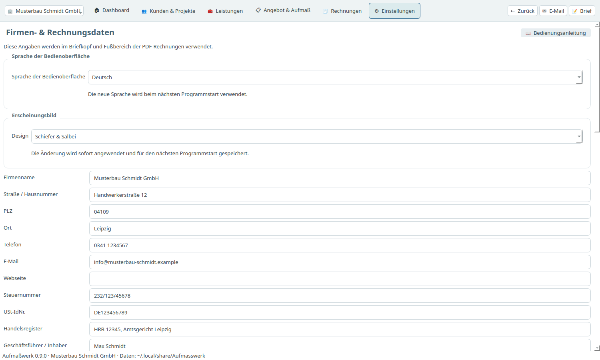

1. Tragen Sie Firmenname, Anschrift, Telefon und E-Mail ein.
2. Tragen Sie **Steuernummer** oder **USt-IdNr.** ein. Mindestens eine von beiden ist für Rechnungen Pflicht.
3. Tragen Sie Bank, IBAN und BIC ein.
4. Wählen Sie bei Bedarf ein Logo aus.
5. Klicken Sie auf **Firmenangaben speichern**.

### Eigenen Briefbogen verwenden

Wenn Sie einen fertigen Briefbogen als PDF haben, können Sie ihn hinterlegen. Angebote, Rechnungen, Mahnungen, Aufmaße und Briefe werden dann darauf gedruckt.

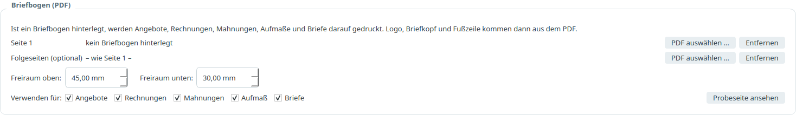

Wählen Sie das PDF für Seite 1 und, falls vorhanden, eines für die Folgeseiten. Mit „Freiraum oben“ und „Freiraum unten“ legen Sie fest, wo der Text beginnt und endet.

### Mehrere Firmen

Über das Feld ganz oben links können Sie eine weitere Firma anlegen und zwischen Firmen wechseln. Jede Firma hat ihre eigenen Daten.

## 2. Kunden und Projekte

Im Bereich **Kunden & Projekte** laufen alle Fäden zusammen. Jedes Angebot und jede Rechnung gehört zu einem Projekt, und jedes Projekt gehört zu einem Kunden.

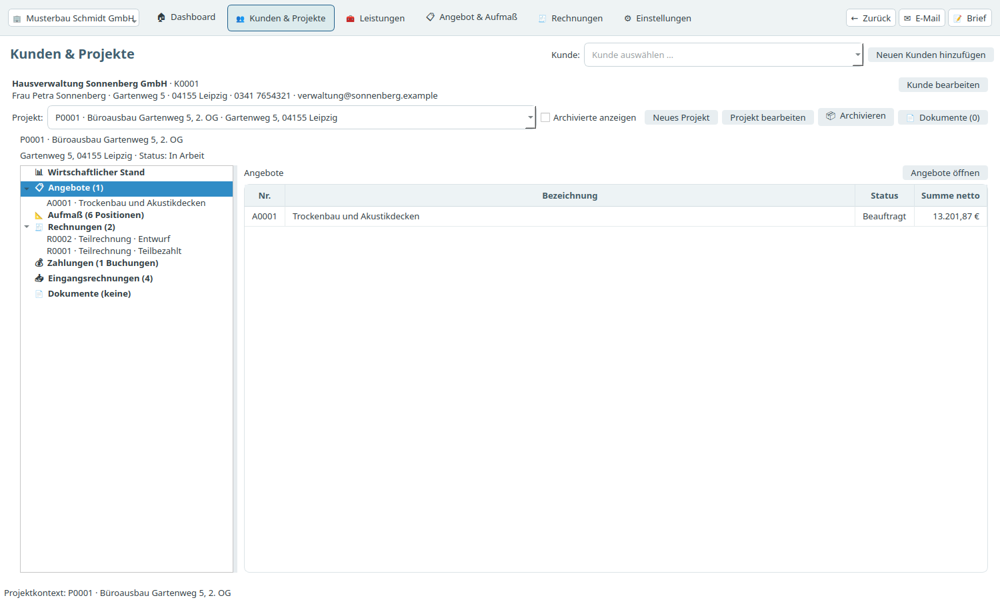

### Kunden anlegen

1. Klicken Sie auf **Neuen Kunden hinzufügen**.
2. Tragen Sie Name und Anschrift ein.
3. Tragen Sie bei Firmenkunden die **USt-IdNr. des Kunden** ein. Für E-Rechnungen nach § 13b ist sie Pflicht.
4. Die **Leitweg-ID** brauchen Sie nur bei öffentlichen Auftraggebern.

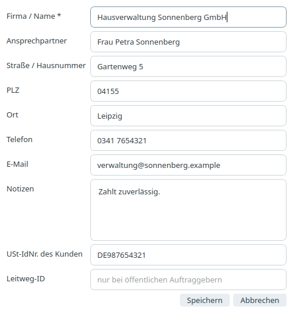

### Projekt anlegen

1. Wählen Sie oben den Kunden aus.
2. Klicken Sie auf **Neues Projekt** und geben Sie Bezeichnung und Baustelle ein.

Mit **Projekt bearbeiten** ändern Sie Name, Baustelle, Status und Notizen. Dort können Sie eine Fehlanlage auch löschen.

### Der Projektinhalt

Links sehen Sie, was zu einem Projekt gehört: wirtschaftlicher Stand, Angebote, Aufmaß, Rechnungen, Zahlungen, Eingangsrechnungen und Dokumente. Ein Klick zeigt rechts die Vorschau. Ein Doppelklick oder der Knopf **Öffnen** springt in den passenden Bereich.

### Dokumente zum Projekt

Über **Dokumente** legen Sie Bilder, Baupläne und andere Dateien zum Projekt ab. Erzeugte Angebote und Rechnungen landen dort automatisch.

### Projekt archivieren

Mit **Archivieren** blenden Sie ein abgeschlossenes Projekt aus. Es geht nichts verloren. Über das Häkchen **Archivierte anzeigen** holen Sie es zurück, mit **Wiederherstellen** kommt es wieder in die normale Liste.

## 3. Angebot schreiben

Öffnen Sie **Angebot & Aufmaß**.

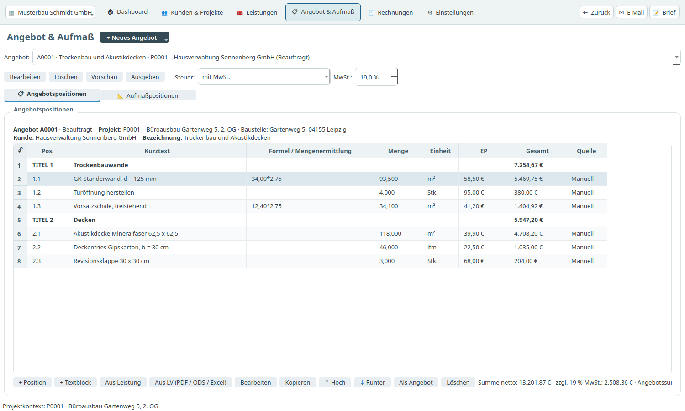

### Neues Angebot

1. Klicken Sie auf **+ Neues Angebot** und wählen Sie das Projekt.
2. Klicken Sie auf **+ Position**. Es erscheint eine leere Zeile.
3. Schreiben Sie direkt in die Zellen: Positionsnummer, Kurztext, Menge oder Formel, Einheit und Einzelpreis.
4. Mit der **Tab-Taste** springen Sie zur nächsten Zelle. Nach dem Einzelpreis legt Tab die nächste Zeile an.

### Gut zu wissen

- **Formel:** In der Spalte „Formel“ können Sie rechnen lassen, zum Beispiel `34,00*2,75`. Die Menge ergibt sich daraus.
- **Langtext und Titel:** Markieren Sie die Position und klicken Sie auf **Bearbeiten**, oder nutzen Sie den Rechtsklick. Titel gliedern das Angebot (zum Beispiel „Trockenbauwände“ und „Decken“) und bekommen eigene Zwischensummen.
- **Textblock:** Mit **+ Textblock** fügen Sie freien Text zwischen den Positionen ein.
- **Reihenfolge:** Mit **Hoch** und **Runter** verschieben Sie Positionen.
- **Steuer:** Über dem Angebot wählen Sie „mit MwSt.“ oder „§ 13b“ und den Steuersatz.

### Positionen übernehmen statt tippen

- **Aus Leistung:** übernimmt Positionen aus Ihrer Leistungssammlung (Kapitel 5).
- **Aus LV (PDF / ODS / Excel):** liest ein Leistungsverzeichnis ein. Sie wählen aus, welche Positionen ins Angebot kommen.

### Angebot ausgeben

**Vorschau** zeigt das Angebot als PDF. **Ausgeben** speichert es. Mit dem Knopf **E-Mail** oben rechts öffnet sich Ihr E-Mail-Programm mit dem Angebot als Anhang.

Setzen Sie den Status über **Bearbeiten** auf **Beauftragt**, sobald der Kunde zugesagt hat. Erst dann zählt das Angebot als Auftragssumme.

## 4. Aufmaß

Das Aufmaß gehört zum Angebot. Wechseln Sie im Bereich **Angebot & Aufmaß** auf den Reiter **Aufmaßpositionen**.

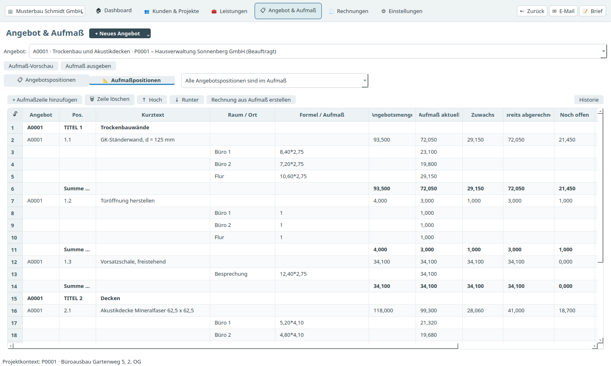

1. Wählen Sie über das Auswahlfeld **Angebotsposition zum Aufmaß hinzufügen** die Positionen aus, die Sie aufmessen.
2. Markieren Sie eine Position und klicken Sie auf **+ Aufmaßzeile hinzufügen**.
3. Schreiben Sie **Raum / Ort** und die **Formel** direkt in die Zeile, zum Beispiel „Büro 1“ und `8,40*2,75`.
4. Die **Tab-Taste** in der Formel legt sofort die nächste Zeile darunter an.

Eine Zeile löschen Sie mit **Zeile löschen**, mit der Entf-Taste oder per Rechtsklick.

**Reihenfolge:** Eine neue Position erscheint am Ende ihres Titels. Mit **Hoch** und **Runter** schieben Sie die markierte Position innerhalb ihres Titels an die gewünschte Stelle. Ist eine einzelne Aufmaßzeile markiert, wandert diese Zeile. Das Angebot bleibt dabei unverändert. Eine Rechnung aus dem Aufmaß übernimmt die Reihenfolge des Aufmaßes.

Die Spalten rechts zeigen je Position die Angebotsmenge, den aktuellen Aufmaßstand, was bereits abgerechnet ist und was noch offen ist.

**Aufmaß-Vorschau** und **Aufmaß ausgeben** erzeugen das Aufmaßblatt als PDF.

## 5. Leistungen

Der Bereich **Leistungen** ist Ihre Sammlung. Jede Position, die Sie einmal in einem Angebot verwendet haben, wird dort dauerhaft aufbewahrt, auch wenn das Angebot später gelöscht wird.

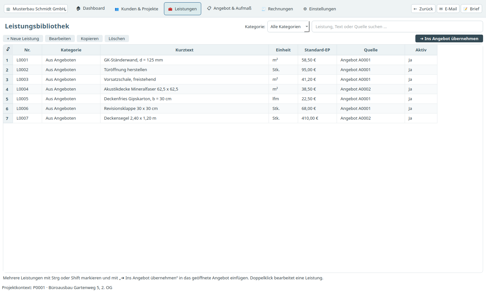

1. Suchen Sie die gewünschten Leistungen.
2. Markieren Sie mehrere mit **Strg** (einzeln) oder **Umschalt** (von–bis).
3. Klicken Sie auf **Ins Angebot übernehmen**. Die Leistungen landen im geöffneten Angebot.

Ein Doppelklick öffnet eine Leistung zum Bearbeiten.

## 6. Rechnungen schreiben

Öffnen Sie **Rechnungen**. Der Reiter **Ausgangsrechnungen** zeigt Ihre Rechnungen an Kunden.

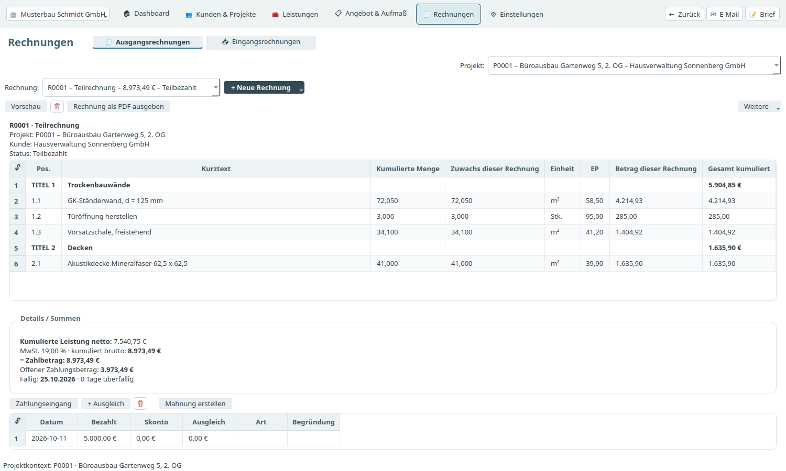

### Neue Rechnung

Über **+ Neue Rechnung** gibt es drei Wege:

- **Rechnung aus Aufmaß:** der übliche Weg. Das Programm übernimmt den aktuellen Aufmaßstand.
- **Freie Rechnung:** eine Rechnung ohne Aufmaß mit eigenen Positionen.
- **Vorhandenen Beleg übernehmen:** für den Einstieg mitten in einem Projekt. Sie tragen eine bereits gestellte Teil- oder Abschlagsrechnung mit ihrer Originalnummer nach.

### Teilrechnungen und Schlussrechnung

Teilrechnungen sind **kumuliert**: Jede zeigt den gesamten Leistungsstand bis dahin. Zahlungen und Skonti aus früheren Teilrechnungen zieht das Programm automatisch ab. Die Schlussrechnung berücksichtigt zusätzlich erhaltene Abschläge.

### Entwurf, Vorschau und Freigabe

Eine neue Rechnung ist zuerst ein **Entwurf** und lässt sich frei ändern.

1. Prüfen Sie Positionen, Fälligkeit, Skonto und eventuelle Einbehalte.
2. Klicken Sie auf **Vorschau & Freigabe**. Die PDF-Vorschau zeigt die Rechnung so, wie der Kunde sie bekommt.
3. Geben Sie die Rechnung frei. **Danach ist sie festgeschrieben** und bekommt den Status „Offen“.

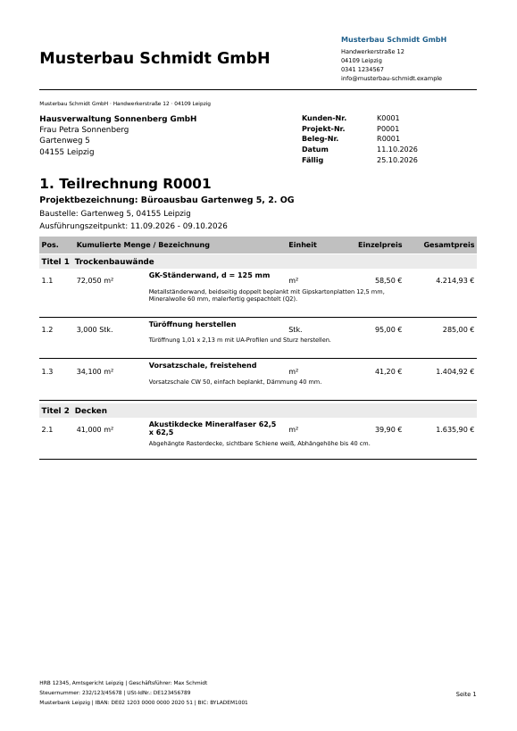

### Rechnung versenden

**Rechnung als PDF ausgeben** speichert die Rechnung. Der Knopf **E-Mail** oben rechts öffnet Ihr E-Mail-Programm mit der Rechnung als Anhang.

### Zahlungseingang und Mahnung

- **Zahlungseingang:** Markieren Sie die Rechnung und tragen Sie Datum, Betrag und gegebenenfalls Skonto ein. Der Status wechselt auf „Teilbezahlt“ oder „Bezahlt“.
- **+ Ausgleich:** für Beträge, die Sie nicht mehr einfordern, zum Beispiel eine Kürzung.
- **Mahnung erstellen:** erzeugt eine Zahlungserinnerung oder Mahnung als PDF. Fällige Mahnungen zeigt auch das Dashboard an.

## 7. E-Rechnung (ZUGFeRD)

Rechnungen zwischen Unternehmen müssen in Deutschland schrittweise als E-Rechnung gestellt werden. Aufmaßwerk erzeugt dafür **ZUGFeRD-Rechnungen im Profil EN 16931**: Die Rechnung sieht aus wie ein gewöhnliches PDF, enthält aber zusätzlich alle Rechnungsdaten in maschinenlesbarer Form.

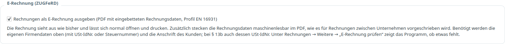

### So funktioniert es

Sie müssen nichts Besonderes tun. Sobald Sie eine Rechnung als PDF ausgeben oder per E-Mail versenden, bettet das Programm die Rechnungsdaten ein. In den Einstellungen lässt sich das abschalten.

### Was dafür vorhanden sein muss

- Ihre Firmendaten mit Anschrift und **Steuernummer oder USt-IdNr.**
- Name und Anschrift des Kunden.
- Bei Rechnungen nach **§ 13b** die **USt-IdNr. des Kunden**.

Unter **Rechnungen → Weitere → E-Rechnung prüfen** zeigt das Programm für die gewählte Rechnung, ob etwas fehlt. Fehlt eine Pflichtangabe, entsteht ein normales PDF, und das Programm sagt, was noch einzutragen ist.

### Einbehalte

Sicherheitseinbehalt und Bauabzug kennt die Norm nicht als eigenes Feld. Sie stehen deshalb als Text in den Zahlungsbedingungen der E-Rechnung. Der dort genannte fällige Betrag ist der Betrag vor Einbehalt. Bitte stimmen Sie dieses Vorgehen mit Ihrem Steuerberater ab.

### Eingehende E-Rechnungen

Wenn Sie bei einer Eingangsrechnung einen Beleg auswählen, der selbst eine E-Rechnung ist (ZUGFeRD-PDF oder XRechnung-XML), füllt das Programm Lieferant, Nummer, Datum und Beträge automatisch aus. Bitte prüfen Sie die Angaben vor dem Speichern.

## 8. Eingangsrechnungen und wirtschaftlicher Stand

### Eingangsrechnungen erfassen

Im Bereich **Rechnungen** erfassen Sie auf dem Reiter **Eingangsrechnungen** die Rechnungen Ihrer Lieferanten und Nachunternehmer.

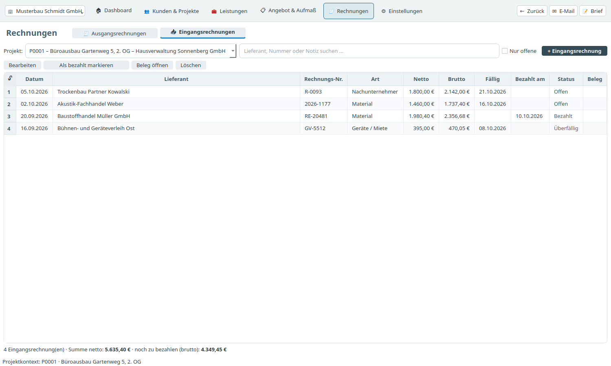

1. Klicken Sie auf **+ Eingangsrechnung**.
2. Wählen Sie das Projekt und tragen Sie Lieferant, Rechnungsnummer und Datum ein.
3. Wählen Sie die **Art der Kosten**: Material, Nachunternehmer, Geräte / Miete oder Sonstiges. Sie können auch eine eigene Art eintippen.
4. Tragen Sie den Betrag netto oder brutto ein. Den anderen Wert rechnet das Programm aus.
5. Über **Beleg auswählen** hängen Sie die eingescannte Rechnung an. Sie wird in die Dokumente des Projekts kopiert.

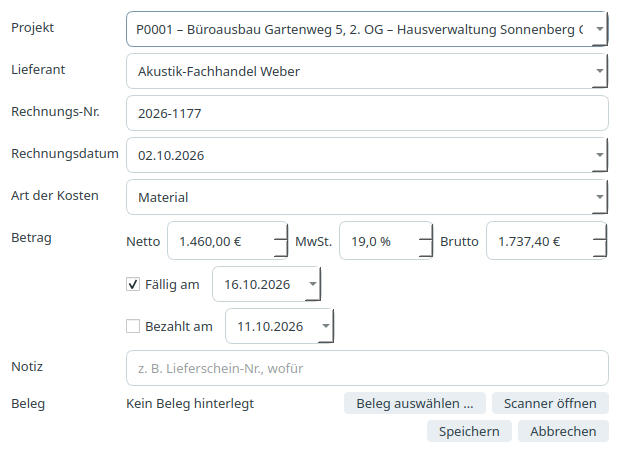

Mit **Als bezahlt markieren** halten Sie fest, dass Sie die Rechnung beglichen haben. **Beleg öffnen** zeigt die hinterlegte Datei.

### Wirtschaftlicher Stand eines Projekts

Wählen Sie unter **Kunden & Projekte** ein Projekt. Ganz oben im Projektinhalt steht **Wirtschaftlicher Stand**.

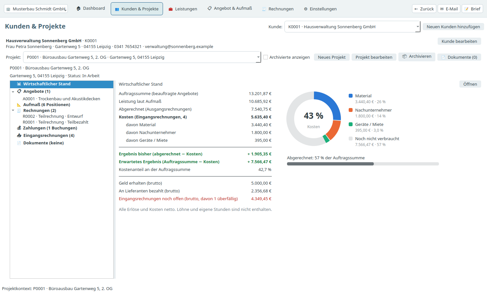

- **Auftragssumme:** die Summe der beauftragten Angebote.
- **Leistung laut Aufmaß** und **Abgerechnet:** wie weit das Projekt ist und wie viel davon schon in Rechnung gestellt wurde.
- **Kosten:** die Eingangsrechnungen, aufgeteilt nach Art.
- **Ergebnis bisher** und **Erwartetes Ergebnis:** was nach Abzug der Kosten übrig bleibt. Ein Minus erscheint rot.
- **Ring-Diagramm:** zeigt, wie viel Prozent der Auftragssumme die Kosten schon verbraucht haben.

Alle Erlöse und Kosten sind netto gerechnet. Löhne und eigene Stunden sind nicht enthalten.

## 9. Datensicherung

Die Datensicherung finden Sie in den **Einstellungen**.

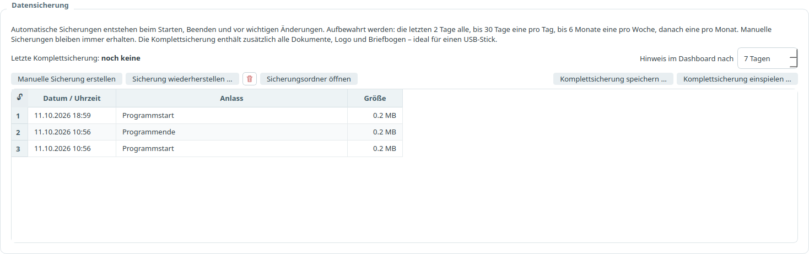

- **Automatische Sicherungen** entstehen beim Starten, beim Beenden und vor wichtigen Änderungen.
- **Komplettsicherung speichern:** speichert alle Daten und Dokumente in einer einzigen Datei. Legen Sie diese Datei regelmäßig auf einen USB-Stick. Das Dashboard erinnert Sie daran.
- **Komplettsicherung einspielen:** stellt alles aus einer solchen Datei wieder her. So ziehen Sie auch auf einen neuen Rechner um.
- **Sicherung wiederherstellen:** setzt die Datenbank auf einen früheren Stand zurück.

## 10. Das Dashboard

Das Dashboard ist die Startseite.

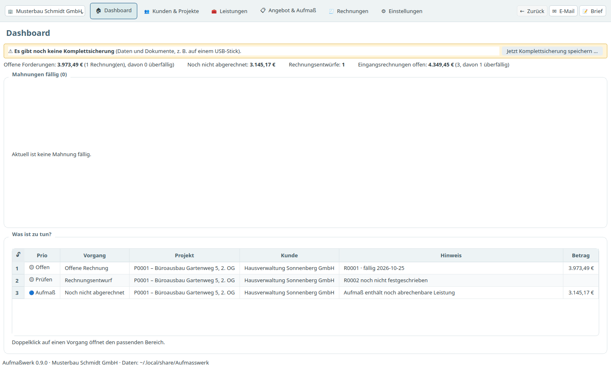

- **Kennzahlen:** offene Forderungen, noch nicht abgerechnete Leistung, Rechnungsentwürfe und offene Eingangsrechnungen.
- **Mahnungen fällig:** überfällige Rechnungen. Mit **Mahnen** erstellen Sie die Mahnung als PDF und auf Wunsch gleich die E-Mail dazu.
- **Was ist zu tun?:** offene Vorgänge. Ein Doppelklick öffnet den passenden Bereich.

## 11. Briefe und E-Mail

- **Brief** (oben rechts) erstellt einen Geschäftsbrief an einen Kunden, auf Wunsch mit Bezug auf ein Projekt.
- **E-Mail** (oben rechts) öffnet einen Entwurf in Ihrem E-Mail-Programm, mit dem passenden PDF als Anhang. Aufmaßwerk versendet selbst keine E-Mails und speichert keine Zugangsdaten.

## 12. Wo liegen meine Daten?

Alle Daten liegen im Ordner `~/.local/share/Aufmasswerk` in Ihrem persönlichen Verzeichnis: die Datenbank, die erzeugten Dokumente, die Sicherungen und die Einstellungen. Wer schon eine frühere Fassung des Programms benutzt hat, behält seinen bisherigen Datenordner. Das Programm selbst ist nur die eine Datei `aufmasswerk.appimage`. Ein Update bedeutet: diese Datei ersetzen. Ihre Daten bleiben dabei erhalten.
